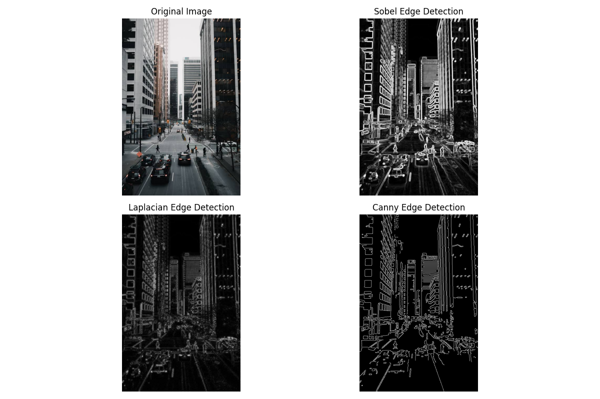
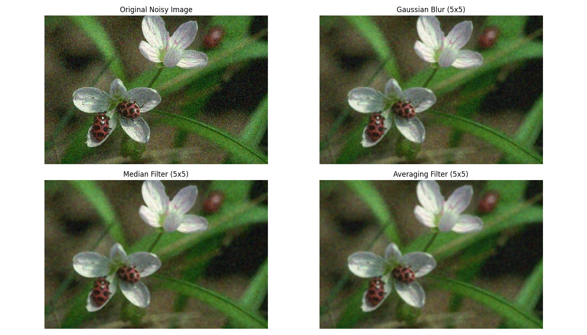
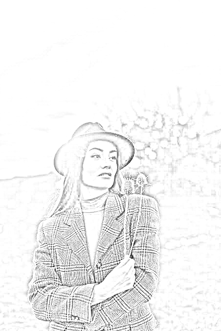
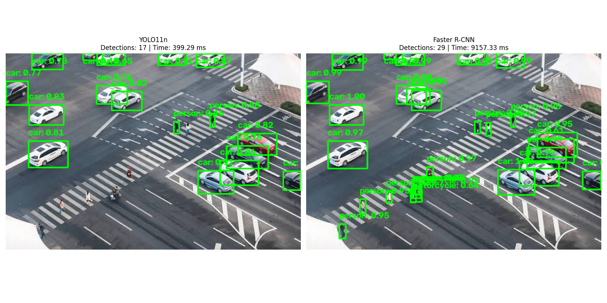

<div align="center">

# 🖼️ Image Processing & Computer Vision

**A collection of hands-on image processing and computer vision projects implemented in Python and OpenCV.**

[](https://www.python.org/)
[](https://opencv.org/)
[](https://pytorch.org/)
[](LICENSE)

*Author: **Smiruthi M.S.***

</div>

---

## 📌 Table of Contents

- [Overview](#-overview)
- [Projects at a Glance](#-projects-at-a-glance)
- [Technologies Used](#-technologies-used)
- [Repository Structure](#-repository-structure)
- [Installation & Setup](#-installation--setup)
- [Project Details](#-project-details)
  - [1. Edge Detection](#1-edge-detection)
  - [2. Image Smoothing & Blurring](#2-image-smoothing--blurring)
  - [3. Pencil Sketch Converter](#3-pencil-sketch-converter)
  - [4. Smart Selfie / Smile Detection](#4-smart-selfie--smile-detection)
  - [5. Traffic Scene Analysis (YOLO)](#5-traffic-scene-analysis-yolo)
  - [6. YOLO vs Faster R-CNN Model Comparison](#6-yolo-vs-faster-r-cnn-model-comparison)
- [Sample Outputs](#-sample-outputs)
- [Learning Objectives](#-learning-objectives)
- [Future Improvements](#-future-improvements)
- [Author](#-author)
- [License](#-license)

---

## 🔭 Overview

This repository contains six practical projects that explore the fundamentals and advanced techniques of **image processing** and **computer vision** using Python. Each project is self-contained and demonstrates a specific set of algorithms — from classical edge-detection operators to modern deep-learning-based object detectors.

The projects are designed to:
- Build intuition about how classical CV algorithms work under the hood.
- Compare algorithm performance quantitatively (timing, detection accuracy).
- Apply state-of-the-art deep learning models (YOLOv11, Faster R-CNN) to real-world scenes.

---

## 🗂️ Projects at a Glance

| # | Project | Key Techniques | Input | Output |
|---|---------|---------------|-------|--------|
| 1 | **Edge Detection** | Sobel, Laplacian, Canny | JPEG image | Comparison grid PNG |
| 2 | **Image Smoothing & Blurring** | Gaussian Blur, Median Filter, Averaging Convolution | Noisy WebP image | Comparison grid PNG |
| 3 | **Pencil Sketch Converter** | Grayscale, Inversion, Gaussian Blur, Color-Dodge | JPEG portrait | Sketch PNG |
| 4 | **Smart Selfie / Smile Detection** | Haar Cascade face & smile detection | Live webcam | Real-time display |
| 5 | **Traffic Scene Analysis** | YOLO11x, tiled detection, morphological ops | Traffic JPEG | Annotated JPEGs |
| 6 | **YOLO vs Faster R-CNN Comparison** | YOLO11n, Faster R-CNN ResNet50, mAP evaluation | Traffic JPEG / COCO | Comparison PNG |

---

## 🛠️ Technologies Used

| Library | Version | Purpose |
|---------|---------|---------|
| `opencv-python` | ≥ 4.8 | Core image I/O, classical CV algorithms, Haar cascades |
| `numpy` | ≥ 1.24 | Array operations, custom convolution kernels |
| `matplotlib` | ≥ 3.7 | Multi-panel result visualization |
| `Pillow` | ≥ 10.0 | Image loading support for PyTorch models |
| `ultralytics` | ≥ 8.0 | YOLO11 model loading and inference |
| `torch` | ≥ 2.0 | Deep learning inference, NMS ops |
| `torchvision` | ≥ 0.15 | Faster R-CNN pretrained model, batched NMS |

---

## 📁 Repository Structure

```
image_processing/
│
├── edge_detection/                    # Project 1: Edge Detection
│   ├── images/
│   │   └── input.jpeg                 # Input image
│   ├── edge_detection.py              # Main script
│   └── edge_detection_results.png     # Output: comparison grid
│
├── edge_detection/image_smoothing/    # Project 2: Image Smoothing
│   ├── noisy_image.webp               # Input noisy image
│   ├── image_smoothing.py             # Main script
│   ├── smoothing_comparison.png       # Output: comparison grid
│   └── gaussian_comparison.png        # Output: Gaussian detail
│
├── edge_detection/pencil_sketch/      # Project 3: Pencil Sketch
│   ├── girl.jpeg                      # Input portrait
│   ├── pencil_sketch.py               # Main script
│   └── pencil_sketch_result.png       # Output: sketch result
│
├── edge_detection/smile_detection/    # Project 4: Smile Detection
│   └── smile_detection.py             # Main script (webcam)
│
├── traffic.py                         # Project 5: Traffic Analysis
├── traffic.jpeg                       # Input traffic scene
│
├── model_comparsion/                  # Project 6: Model Comparison
│   ├── compare_models.py              # Side-by-side visual comparison
│   ├── evaluate_model.py              # mAP evaluation on COCO
│   ├── traffic.jpeg                   # Input image
│   ├── yolo11n.pt                     # YOLO11n weights (download separately)
│   └── model_comparison.png           # Output: comparison grid
│
├── docs/images/                       # README screenshots
│
├── requirements.txt                   # Python dependencies
├── .gitignore                         # Exclusions (models, datasets, cache)
├── LICENSE                            # MIT License
└── README.md                          # This file
```

> **Note:** YOLO model weight files (`*.pt`) are excluded from the repository due to size. Download them from [Ultralytics](https://docs.ultralytics.com/models/yolo11/) and place them in the appropriate folder before running.

---

## ⚙️ Installation & Setup

### Prerequisites

- Python **3.8 or later**
- pip

### 1. Clone the repository

```bash
git clone https://github.com/Smiruthi-MS/Image-Processing.git
cd Image-Processing
```

### 2. Create and activate a virtual environment *(recommended)*

```bash
# Windows
python -m venv venv
venv\Scripts\activate

# macOS / Linux
python -m venv venv
source venv/bin/activate
```

### 3. Install dependencies

```bash
python -m pip install -r requirements.txt
```

> **GPU users:** Replace the PyTorch install with the CUDA build from [pytorch.org/get-started/locally](https://pytorch.org/get-started/locally/).

### 4. Download YOLO model weights *(for Projects 5 & 6)*

```bash
# YOLO11n — fast nano model (used in model comparison)
python -c "from ultralytics import YOLO; YOLO('yolo11n.pt')"

# YOLO11x — large accurate model (used in traffic analysis)
python -c "from ultralytics import YOLO; YOLO('yolo11x.pt')"
```

Place the downloaded `*.pt` files:
- `yolo11x.pt` → project root (beside `traffic.py`)
- `yolo11n.pt` → `model_comparsion/`

---

## 📂 Project Details

---

### 1. Edge Detection

**Location:** `edge_detection/`

#### Description
Compares three classical gradient-based edge detection algorithms on the same input image and reports their processing times.

#### Algorithms Implemented

| Algorithm | Method | Strength |
|-----------|--------|---------|
| **Sobel** | First-order gradient (∂x, ∂y), combined via magnitude | Directional, smooth edges |
| **Laplacian** | Second-order derivative (∇²) | Sensitive, detects fine details |
| **Canny** | Multi-stage: Gaussian → Gradient → NMS → Hysteresis | Best overall; thin, clean edges |

#### Pipeline
```
Input Image → Grayscale → Gaussian Blur (5×5)
   ├─ Sobel (ksize=3, x+y combined)
   ├─ Laplacian (ksize=3)
   └─ Canny (thresholds: 100, 200)
         → Comparison Grid saved as edge_detection_results.png
```

#### Run

```bash
cd edge_detection
python edge_detection.py
```

**Expected output:** `edge_detection_results.png` — a 2×2 panel showing Original, Sobel, Laplacian and Canny results plus timing stats in the terminal.

---

### 2. Image Smoothing & Blurring

**Location:** `edge_detection/image_smoothing/`

#### Description
Demonstrates three spatial-domain smoothing techniques on a noisy image and benchmarks each method.

#### Algorithms Implemented

| Filter | Kernel / Method | Best For |
|--------|----------------|---------|
| **Gaussian Blur** | Weighted Gaussian kernel 5×5 | General noise reduction |
| **Median Filter** | Replaces pixel with neighborhood median | Salt-and-pepper noise |
| **Averaging (Box) Filter** | Uniform 5×5 kernel via `cv2.filter2D` | Simple spatial convolution demo |

#### Run

```bash
cd edge_detection/image_smoothing
python image_smoothing.py
```

**Expected output:** `smoothing_comparison.png` — a 2×2 panel; timing printed to terminal.

---

### 3. Pencil Sketch Converter

**Location:** `edge_detection/pencil_sketch/`

#### Description
Transforms a photographic portrait into a realistic grayscale pencil sketch using only classical image operations — no deep learning required.

#### Pipeline

```
Original Image
  │
  ▼ Grayscale Conversion
  │
  ▼ Invert Grayscale (255 − pixel)
  │
  ▼ Gaussian Blur on Inverted (kernel 21×21)
  │
  ▼ Invert Blurred Image
  │
  ▼ Color-Dodge Blend: sketch = gray / inverted_blur × 256
  │
  ▼ pencil_sketch_result.png
```

#### Run

```bash
cd edge_detection/pencil_sketch
python pencil_sketch.py
```

**Expected output:** `pencil_sketch_result.png` — the pencil sketch, plus a 6-panel process visualization window.

---

### 4. Smart Selfie / Smile Detection

**Location:** `edge_detection/smile_detection/`

#### Description
Real-time face and smile detection using OpenCV's pre-trained **Haar Cascade** classifiers. Displays a live webcam window that labels each face with a **SMILE DETECTED / NO SMILE** status.

#### How It Works

1. **Face detection** — `haarcascade_frontalface_default.xml` scans the full frame at multiple scales.
2. **Smile detection** — `haarcascade_smile.xml` runs only within each detected face ROI.
3. Bounding boxes are drawn in real time; smile status is overlaid in green (detected) or red (not detected).

#### Haar Cascade Parameters

| Parameter | Value | Effect |
|-----------|-------|--------|
| `scaleFactor` (face) | 1.3 | Scale step between pyramid layers |
| `minNeighbors` (face) | 5 | Minimum detections to retain a face |
| `minSize` (face) | 80×80 | Minimum face size in pixels |
| `minNeighbors` (smile) | 20 | High value → fewer false positives |

#### Run

```bash
cd edge_detection/smile_detection
python smile_detection.py
```

> ⚠️ **Requires a connected webcam.** Press **Q** to quit.

---

### 5. Traffic Scene Analysis (YOLO)

**Location:** `traffic.py` (project root)

#### Description
Analyses a dense traffic scene with:
- **Morphological road-marking detection** (adaptive thresholding + contour filtering for zebra crossings)
- **YOLO11x tiled object detection** — the scene is passed at full resolution *and* sliced into overlapping tiles so small/distant people and vehicles are detected reliably
- **Class-wise NMS** via `torchvision.ops.batched_nms` to merge duplicate detections across tiles

#### Detected Classes

| Class ID | Label | Colour |
|----------|-------|--------|
| 0 | Person | Green |
| 2 | Car | Orange |
| 3 | Motorcycle | Orange |
| 5 | Bus | Orange |
| 7 | Truck | Orange |

#### Run

```bash
# From project root (image_processing/)
python traffic.py
```

> Requires `yolo11x.pt` and `traffic.jpeg` in the same directory.

---

### 6. YOLO vs Faster R-CNN Model Comparison

**Location:** `model_comparsion/`

#### Description
Quantitatively and visually compares two state-of-the-art object detectors on the same traffic scene:

| Model | Architecture | Speed | Accuracy |
|-------|-------------|-------|---------|
| **YOLO11n** | Single-stage anchor-free | ⚡ Fast | ★★★☆ |
| **Faster R-CNN ResNet50-FPN** | Two-stage region-proposal | 🐢 Slower | ★★★★ |

**`compare_models.py`** — visual side-by-side on `traffic.jpeg`, repeated 10× for timing benchmarks.

**`evaluate_model.py`** — computes per-class **Precision**, **Recall** and **mAP@IoU=0.5** on a subset of the COCO 2017 validation set (requires the dataset).

#### Run (visual comparison — no dataset needed)

```bash
cd model_comparsion
python compare_models.py
```

#### Run (quantitative mAP evaluation — COCO dataset required)

```bash
# Download COCO val2017 into model_comparsion/dataset/
cd model_comparsion
python evaluate_model.py
```

---

## 🖼️ Sample Outputs

### Edge Detection Results


### Image Smoothing Comparison


### Pencil Sketch Converter


### YOLO vs Faster R-CNN Comparison


---

## 🎓 Learning Objectives

After exploring this repository you will understand:

- How **gradient operators** (Sobel, Laplacian) and **multi-stage pipelines** (Canny) extract edges from images.
- The difference between **linear** (Gaussian, Averaging) and **non-linear** (Median) spatial filters and when to use each.
- How the **color-dodge** blending formula produces a pencil-sketch effect without any neural network.
- How **Haar Cascade** classifiers use integral images for real-time face and landmark detection.
- How **single-stage detectors** (YOLO) differ architecturally from **two-stage detectors** (Faster R-CNN) and what that means for the speed/accuracy trade-off.
- How **tiled inference** with overlapping crops improves detection of small or distant objects.
- How to compute **IoU**, **Precision**, **Recall**, and **mAP** to evaluate an object detector.

---

## 🚀 Future Improvements

- [ ] Add **semantic segmentation** using DeepLab or SegFormer.
- [ ] Add **optical flow** (Lucas-Kanade / Farneback) for motion estimation.
- [ ] Extend smile detection to **emotion classification** using a CNN (FER dataset).
- [ ] Replace YOLO11n with **YOLO11s/m** for a better accuracy point in the model comparison.
- [ ] Package each project as a **Streamlit web app** for browser-based demos.
- [ ] Add a **GitHub Actions CI** workflow to run static analysis (`flake8`, `pylint`) on every push.
- [ ] Add **unit tests** for utility functions (IoU, NMS, kernel operations).

---

## 👩‍💻 Author

**Smiruthi M.S.**

> *Passionate about computer vision, deep learning and building projects that bridge theory and practical application.*

---

## 📄 License

This project is licensed under the **MIT License** — see the [LICENSE](LICENSE) file for details.

---

<div align="center">

⭐ *If you found this repository helpful, consider giving it a star!* ⭐

</div>
